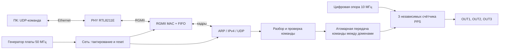

# Архитектура генератора Ethernet → 3 × PPS

Статус: генератор PPS и тестовая оболочка Smart Artix реализованы, собраны и проверены логическим анализатором. Архитектура Ethernet ниже остаётся планом и не реализована. Параметры сетевого протокола — рабочие значения, которые можно изменить.

**Уточнение для первой проверки на Smart Artix:** пользователь выбрал внутреннюю имитацию опоры 10 МГц из штатных 50 МГц платы. Для существующего модуля `pps_generator` предполагается получить 10 МГц через MMCM/Clocking Wizard; необходимы проверка параметров IP, `LOCKED`, reset и XDC. Внешний 10-МГц вход и CDC к нему остаются последующим вариантом. Схема и описание внешнего входа ниже относятся к этому будущему варианту и пока не реализованы.

## Функциональные блоки

1. **Платозависимая оболочка** `smart_artix_top`: входы такта, цифровой опоры и reset, RGMII/PHY и три PPS; здесь же Xilinx clock primitives и привязка к плате. Все GPIO и стандарты назначаются позднее по проверенной ревизии.
2. **Ethernet**: MAC с RGMII и FIFO, ARP/IPv4/UDP. Подходящий кандидат — [verilog-ethernet](https://github.com/alexforencich/verilog-ethernet), модули `eth_mac_1g_rgmii_fifo` и `udp_complete`. Репозиторий под MIT, объявлен автором устаревшим и заменён проектом Taxi; для учебного проекта он выбран за готовые Verilog-модули и примеры 7 Series. На 7 ноября 2026 проверен HEAD `77320a9471d19c7dd383914bc049e02d9f4f1ffb`; при импорте закрепить этот коммит и все соответствующие версии зависимостей, лицензии и заметки об изменениях. Он ещё не скачан и не проверен сборкой на Vivado 2019.1/Smart_Artix; при несовместимости подобрать исправление или альтернативу и зафиксировать его.
3. **Парсер UDP**: принимает только пакеты заданного локального адреса/порта и полный корректный payload; после успешной проверки передаёт одну команду в очередь CDC. Временный простой формат 2 байта: байт 0 — номер выхода 1–3, байт 1 — код режима `0=OFF`, `1=1 PPS`, `2=10 PPS`, `3=100 PPS`. Другая длина, номер или код — команда отклоняется, состояние не меняется. Адрес, порт и MAC определить при интеграции. ARP нужен для обычной адресации IPv4; ICMP, DHCP, TCP, веб-интерфейс, сохранение после выключения и ответы на команды не входят в минимальную версию.
4. **CDC**: асинхронный FIFO команд с сигналом full либо однозаписный handshake с гарантией удержания многобитных данных и синхронизированными request/ack. Предпочтительна очередь FIFO с явной глубиной и индикацией overflow; не синхронизировать каждый бит команды независимо. Один принятый элемент содержит номер канала и режим. При заполнении очередь отклоняет новую команду и учитывает переполнение; UDP без подтверждения не гарантирует доставку или исполнение. При остановленной опоре FIFO не опустошается. Подтверждение, повторы и диагностика — возможное расширение, не требование пользователя.
5. **PPS** `pps_channel` × 3: синхронные счётчики в домене 10 МГц, режимы OFF/1/10/100. На валидной команде меняется только адресованный канал; реализация применяет настройку на ближайшем такте опоры и перезапускает счётчик выбранного канала. Импульс активен высокий ровно один такт; OFF удерживает выход низким. Начальное состояние всех каналов OFF — временное решение. Период отсчитывается с момента применения; первая активная посылка после полного периода. Эти правила простого переключения — инженерное допущение, не обещание сохранения фазы.

## Тактирование и переходы между доменами

- **PPS:** вход 10 МГц должен идти на согласованный тактовый вывод и глобальную тактовую сеть; три канала и читающая сторона FIFO синхронны ему. После команды каналы независимы. 10 МГц — не входная синусоида в HDL.
- **Сеть и управление:** на основании входных 50 МГц платы получить необходимые такты (для выбранного MAC предполагается 125 МГц и при необходимости сдвинутый на 90° через MMCM/PLL). Реализовать по документации конкретного MAC/PHY и проверить достижимость на целевом part. Домен логики стека выбрать в соответствии с FIFO-оболочкой. Ethernet не зависит от прихода 10 МГц.
- **RGMII RX:** источник такта — `RXC` от PHY; он зависит от согласованной скорости линии. DDR-вход, пересечение в домен стека и восстановление после изменения скорости обеспечить выбранным MAC/FIFO. RXC и 10 МГц считать независимыми. Не считать все внутренние такты автоматически асинхронными: исходные и производные clocks описать корректно.
- **Reset:** для каждого домена асинхронное утверждение и синхронное снятие относительно его работающего такта, включая MMCM `LOCKED`; reset FIFO — в соответствии с документацией выбранной реализации и обоих доменов. Начальное состояние каналов OFF. Если 10 МГц остановился, синхронные регистры не изменяются: высокий импульс может остаться высоким, команды ожидают в FIFO; мгновенное безопасное выключение не гарантируется. Нужна отдельная схема контроля опоры, если это окажется требованием.

## PHY и RGMII: принятый подход и оставшаяся проверка

По схеме Smart_Artix PHY — RTL8211E-VB-CG, RGMII 3,3 В; PHY_AD straps предполагают адрес 3, TXDLY=1 и RXDLY=0. Источник: [разбор схемы](output/altium/component-preparation/evidence/ethernet-review.md) и локальный даташит PHY. Это ориентир по схеме, ревизия физической платы не проверена. Сначала использовать PHY autonegotiation и straps; контролируемый reset через FPGA после стабилизации питания, не мешая straps. Если доступен MDIO, предусмотреть чтение PHY ID/статуса и настроек, а изменение регистров добавлять только по необходимости; точную последовательность reset проверить по datasheet.

Задержки TX и RX согласовать отдельно: при TXDLY=1 PHY уже добавляет задержку в своём направлении; не включать автоматически вторую задержку в FPGA. При RXDLY=0 требуемый сдвиг необходимо обеспечить выбранной схемой приёма (например, IDELAY или иной подтверждённой топологией); конкретную реализацию определить по временным таблицам PHY, MAC и плате. На этапе XDC задать источники и производные такты, ограничения входов/выходов и проверить setup/hold на обеих DDR-границах, включая min/max skew и задержки дорожек. Численные задержки без данных не придумывать; TXDLY/RXDLY, link speed и выбранные опции MAC проверить фактически. Успешный ping/светодиод не заменяют timing и тест трафика.

## Проверка IP и альтернатив

Изолированный Tcl-запрос к каталогу Vivado 2019.1 с `xc7a50tfgg484-2` выполнен без открытия пользовательского проекта: `tri_mode_ethernet_mac:9.0` поддерживает Artix-7 и имеет `REQUIRES_LICENSE=1`; `axi_ethernet:7.1` также указывает лицензионную зависимость. Доступность оплаченной или evaluation-лицензии на этой машине не проверялась. `axi_ethernetlite:3.0` в каталоге без лицензии, но не является готовой заменой RGMII MAC и стеку. `gmii_to_rgmii:4.0` без лицензии, но в локальном перечне поддерживаемых семейств Artix-7 не обнаружен. Поэтому для первого варианта выбран открытый RTL, без утверждения, что его синтез, тайминг или работа на плате уже проверены.

## Контрольные точки реализации

1. Моделирование каждого PPS-канала и изменения одного канала без влияния на другие; измерение полного периода и ширины, OFF и reset.
2. Тест CDC: непрерывная очередь, backpressure/full, остановка/возврат 10 МГц, reset обоих доменов и сохранение целостности команд.
3. Интеграция RGMII MAC и UDP/ARP с моделью PHY; корректный и некорректный трафик, фильтрация и overflow; отдельно проверка лицензий зависимостей и совместимости Vivado 2019.1.
4. Полный синтез/implementation, XDC и timing. Далее физическое подтверждение маркировки и ревизии, периферии, подключения и измерения.
