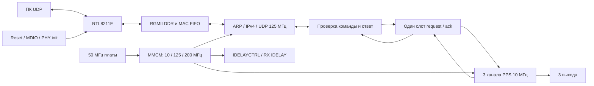

# Архитектура Ethernet → 3 × PPS

Статус 7 ноября 2026: Ethernet и управление реализованы в RTL; проверены
Icarus, XSim 2019.1, синтезом и implementation. Аппаратная проверка новой
прошивки и окончательное подтверждение внешнего RGMII budget остаются открыты.
Точная инструкция, ограничения и протокол — [vivado/README.md](vivado/README.md).

## Ethernet и плата

`smart_artix_top` содержит MMCM, reset synchronizers, MDIO-контроллер и
IDELAYCTRL. Опора PPS сейчас внутренняя: 10 МГц от 50 МГц Y18. Внешняя опора
через компаратор — будущий вариант; её clock input, watchdog и электрическое
согласование не реализованы.

Выбран `eth_mac_1g_rgmii_fifo` + `udp_complete` из verilog-ethernet,
commit `77320a9471d19c7dd383914bc049e02d9f4f1ffb`. Поднабор зависимостей
и axis subtree сохранены с MIT-лицензиями и SHA-256, см.
[third_party](vivado/third_party/README.md). Совместимость с Vivado 2019.1
проверена именно для текущего поднабора. Новые коммерческие IP не требуются.
Upstream устарел в пользу Taxi; автоматического обновления нет.

Назначения RGMII/MDIO/reset повторно сверены по изображениям листов 2 и 5
Smart Artix, банк14 LVCMOS33. XDC другой платы не переносился. PHY address3;
reset10 мс с отпусканием в Z через R52/C670 + ожидание40 мс; проверка ID001c:c915; read-modify-write и проверка
обоих внутренних delay bits page7/ext0xa4/reg0x1c. FPGA TX clk90 выключен.
RX использует BUFIO/BUFR и IDELAYE2 11 taps с опорой200 МГц для компенсации
внутреннего clock/data skew FPGA. EEE advertisement отключён; объявляются
full-duplex10/100/1000, затем перезапускается autonegotiation. При неверном ID,
TA/readback MAC не разрешается до reset. Link/AN контролируются BMSR polling.

## Протокол и состояние

Рабочие временные адреса: MAC02:00:00:00:00:50, IP192.168.1.128/24,
UDP1234. Payload2 байта: channel1..3, mode0..3 (OFF/1/10/100 PPS) либо80h
для чтения. Ответ4 байта: `00 channel applied_mode 01`, на IP/порт отправителя.
Подтверждение генерируется после применения/чтения в домене PPS.

Пакет допускается только после проверки MAC/IP/порта, IPv4 length/header
checksum, отсутствия фрагментации/options, UDP length/checksum, полного
двухбайтового payload и channel/mode. Нулевой UDP checksum разрешён IPv4.
MAC RX frame FIFO отбрасывает кадры с ошибками/FCS до приложения.
Некорректные или занятые команды отбрасываются без ответа; RTL считает
accepted/invalid/overflow. Число принятых парсером пакетов не равно физически
отправленным ответам: ответ может потеряться в UDP/линии.

В обработке одна команда и её ответ; заполненный слот отклоняет новую
команду. Отдельные конечные MAC/UDP FIFO также ограничивают поток.
Клиент должен ждать ответ перед следующей командой. Transaction ID,
дедупликации, гарантии порядка/доставки, DHCP/ICMP/TCP, авторизации и
сохранения состояния нет. Повтор SET снова перезапускает выбранный канал.
Чтение его не перезапускает.

## CDC и reset

Инварианты `command_mailbox`:

1. Источник записывает весь bundle `{read,channel,mode}` и переключает request
   только при ready. Bundle удерживается до ack.
2. Request проходит две стадии ASYNC_REG. Приёмник фиксирует весь стабильный
   bundle в ref-регистре, затем на следующем такте применяет его к выбранному
   каналу либо читает режим. На этом же такте обновляются ответ и ack.
3. Ack проходит две стадии к источнику. Ответ удерживается до следующей
   команды; после ack источник фиксирует его и выдаёт result_valid.
4. Bundle paths ограничены max_delay8 нс, меньше двух ref/net тактов ожидания.
   Биты команды не имеют отдельных синхронизаторов. Тесты останавливают
   каждый домен, проверяют full и reset с pending-командой.
5. Асинхронное утверждение reset общее; снятие синхронное для каждого домена.
   Раздельный reset половины mailbox не поддерживается. Сброс очищает
   pending/request/ack и все режимы, исключая повтор старой команды.

Начальное состояние OFF. PPS-каналы независимы; SET сбрасывает счётчик
только адресованного канала. Первый высокий импульс через полный период,
длительность один такт10 МГц. При остановке такта значение регистра выхода
может остаться высоким; команда остаётся pending. Аппаратного watchdog нет.
В текущей платозависимой оболочке net/ref clocks связаны одним MMCM; FIFO MAC RXC
асинхронен. Связанные clocks не объявлены асинхронными.

## Проверки и допущения timing

Есть MAC/RGMII wire-тест с FCS и ARP, все12 SET, чтения, ошибки, повторы,
независимый PPS scoreboard, остановка обоих доменов, overflow/reset;
отдельные тесты backpressure и модели MDIO. XSim также проверяет полную
оболочку с UNISIM MMCM/IDELAY/DDR, вводя команды на вход mailbox.
Модели не являются аналоговой верификацией PHY/PCB или тестом автосогласования.

STA выполняется на обеих DDR-границах RX/TX. Значения input min1/max3 нс,
TX capture+2 нс и allowance дорожек±0,2 нс — предварительный бюджет на основе
таблицы65 RTL8211E, без подтверждения данной трассировки. Успешный STA не
означает завершённый PVT/duty/skew sign-off. Измерения, реальная ревизия,
режимы10/100 и link recovery требуют аппаратной проверки.

CDC report не подавляется. Предупреждения bundle handshake, frame FIFO
commit-handshake и Gray pointers проверяются по удержанию данных и
max_delay/bus_skew. Исключены только первые синхронизаторы, async reset и
асинхронные внешние управляющие выводы; blanket clock_groups нет.
Результаты и оставшиеся ограничения: [отчёт этапа7](vivado/reports/ethernet_step7/RESULTS.md).
