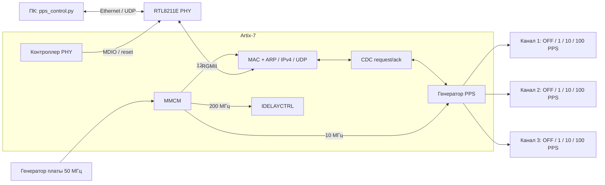

# Генератор PPS на ПЛИС

Курсовой проект устройства, формирующего импульсные последовательности **1, 10 и 100 PPS** с независимым управлением выходными каналами. PPS (pulses per second) — число импульсов в секунду.

Основной стенд — **Smart Artix с FPGA Artix-7 XC7A50T**. Для него реализованы три канала, управление по Ethernet/UDP, чтение состояния и подтверждение применения команд. Репозиторий содержит HDL, ограничения выводов и временных параметров, проект Vivado, готовые прошивки, тесты, отчёты и разрабатываемый проект собственной платы в Altium Designer.

**Состояние на 7 ноября 2026 года:** Ethernet-прошивка прошла моделирование, синтез и реализацию и загружена в SRAM FPGA с `DONE=1`. Сетевой обмен и физические параметры PPS этой прошивки на плате ещё не проверены. Проект собственной платы находится в разработке.

Для запуска стенда перейдите к [краткой инструкции Smart Artix](SMART_ARTIX_START.md); полный порядок подключения, протокол и диагностика описаны в [руководстве Vivado](vivado/README.md).

## Содержание

- [Назначение проекта](#назначение-проекта)
- [Возможности Smart Artix](#возможности-smart-artix)
- [Архитектура](#архитектура)
- [Быстрый запуск](#быстрый-запуск)
- [Сборка и моделирование](#сборка-и-моделирование)
- [Результаты и ограничения](#результаты-и-ограничения)
- [Проект собственной платы](#проект-собственной-платы)
- [Прототип Tang Nano 20K](#прототип-tang-nano-20k)
- [Структура репозитория](#структура-репозитория)
- [Документация](#документация)
- [Лицензии](#лицензии)

## Назначение проекта

Цель — разработать воспроизводимый учебный проект генератора: цифровую логику, средства управления с ПК, схему и печатную плату, а также комплект конструкторской документации по ГОСТ.

Работа ведётся по двум связанным направлениям:

- **Проверка цифровой части на готовой плате.** Smart Artix используется для разработки Ethernet-управления и трёхканального генератора, моделирования и последующих аппаратных измерений.
- **Разработка собственной платы.** В Altium Designer разрабатываются питание, конфигурирование FPGA, интерфейсы, вход внешней опоры и выходные цепи. Для этой части предусмотрена внешняя опора 10 МГц с входным формирователем.

В текущей прошивке Smart Artix опора 10 МГц формируется из штатного генератора платы 50 МГц. Внешняя опора в неё ещё не включена. Привязка импульсов к UTC не реализована и не требуется для текущего стенда.

Изготовление, монтаж и аппаратные испытания собственной платы не входят в текущий объём курсового проекта. Проверки прошивки на готовой Smart Artix выполняются отдельно.

## Возможности Smart Artix

| Параметр | Реализованное поведение |
| --- | --- |
| Целевая FPGA проекта | `xc7a50tfgg484-2` |
| Среда разработки | Vivado 2019.1 |
| Верхний модуль | `smart_artix_top` |
| Число выходов | Три независимых физических канала |
| Режимы каждого канала | `OFF`, `1 PPS`, `10 PPS`, `100 PPS` |
| Начальное состояние | Все каналы `OFF` после включения или сброса |
| Импульс | Активный высокий уровень, один такт опоры; номинально 100 нс |
| Управление | Ethernet → IPv4/UDP; установка режима и чтение состояния |
| Подтверждение | Ответ после применения команды или чтения режима в домене PPS |
| Смена режима | Перезапускается выбранный канал; остальные сохраняют режим и фазу |
| Первый импульс после установки | Через полный период выбранной частоты |

Повторная установка того же режима также перезапускает фазу канала. Чтение состояния фазу не меняет. Одинаковые частоты на разных выходах допустимы.

При номинальной опоре 10 МГц используются следующие периоды:

| Режим | Частота повторения | Период | Тактов опоры на период |
| --- | ---: | ---: | ---: |
| `1 PPS` | 1 Гц | 1 с | 10 000 000 |
| `10 PPS` | 10 Гц | 100 мс | 1 000 000 |
| `100 PPS` | 100 Гц | 10 мс | 100 000 |

Это короткие импульсы, а не меандр с заполнением 50 %. Частота и длительность наследуют погрешность опоры; абсолютная точность аппаратными измерениями пока не установлена.

## Архитектура



Ethernet-часть использует MAC с FIFO и закреплённый сторонний RTL. Контроллер PHY выполняет сброс, настройку по MDIO и проверку результата. Команда и ответ передаются между тактовыми доменами (CDC) как единый набор данных через механизм запроса и подтверждения.

Подробности модулей, тактирования и временных ограничений приведены в [руководстве Vivado](vivado/README.md) и [описании архитектуры](ETHERNET_GENERATOR_ARCHITECTURE.md).

## Быстрый запуск

Команды ниже предназначены для PowerShell и выполняются из корня репозитория.

### 1. Получить проект

```powershell
git clone https://github.com/HomeboyMakkri/fpga-course-work.git
cd fpga-course-work
```

Для стенда нужны Smart Artix, JTAG-подключение, Vivado 2019.1 с поддержкой целевой FPGA, Python 3 и физическое проводное Ethernet-соединение. Клиент управления использует только стандартную библиотеку Python. Для измерения выходов нужен осциллограф или совместимый логический анализатор.

### 2. Проверить плату и загрузить прошивку

Проект Vivado — [ethernet_generator.xpr](vivado/ethernet_generator.xpr). Перед загрузкой сверьте ревизию и маркировку платы с [имеющейся схемой Smart Artix](datasheets/Schematic_Smart_Artix_251120.pdf), а также FPGA и назначения выводов с проектом.

Используйте [smart_artix_ethernet.bit](vivado/bitstream/smart_artix_ethernet.bit). Порядок обнаружения JTAG-устройства и загрузки через штатный скрипт приведён в [SMART_ARTIX_START.md](SMART_ARTIX_START.md). Прошивка загружается в **SRAM FPGA**; запись конфигурационной Flash для этого запуска не требуется. После отключения питания SRAM-конфигурация теряется.

В репозитории также сохранён `smart_artix_pps.bit` — предыдущий автономный вариант. Для управления по Ethernet нужен именно `smart_artix_ethernet.bit`.

### 3. Подключить Ethernet

Подключите RJ45 **J3** к физическому Ethernet/USB–Ethernet-адаптеру ПК или коммутатору. Назначьте проводному интерфейсу ПК свободный адрес `192.168.1.10/24` и дождитесь установления link/autonegotiation.

| Параметр | Значение текущей прошивки |
| --- | --- |
| IPv4 FPGA | `192.168.1.128` |
| MAC FPGA | `02:00:00:00:00:50` |
| UDP-порт | `1234` |
| Адрес ПК в примерах | `192.168.1.10/24` |

Адреса должны быть свободны в используемой сети. DHCP, TCP и ICMP Echo не реализованы: `ping` не служит проверкой этой прошивки. Сетевые параметры FPGA заданы в RTL.

### 4. Настроить каналы

После загрузки все выходы отключены. Следующие команды включают 1, 10 и 100 PPS на каналах 1, 2 и 3 соответственно:

```powershell
python vivado/pps_control.py 1 1 --bind 192.168.1.10
python vivado/pps_control.py 2 10 --bind 192.168.1.10
python vivado/pps_control.py 3 100 --bind 192.168.1.10
```

Прочитать состояние и отключить канал:

```powershell
python vivado/pps_control.py 2 get --bind 192.168.1.10
python vivado/pps_control.py 2 off --bind 192.168.1.10
```

Клиент ожидает подтверждение из домена PPS. При тайм-ауте команда могла исполниться: сначала прочитайте состояние через `get`. Обслуживается одна команда за раз; используйте один клиент и дожидайтесь ответа перед следующей командой. Формат пакетов и обработка ошибок описаны в [протоколе версии 1](vivado/README.md#протокол-версии-1).

### 5. Проверить выходы

| Сигнал | Контакт J5 | Вывод FPGA |
| --- | ---: | --- |
| PPS1 | 7 | B1 |
| PPS2 | 9 | C2 |
| PPS3 | 11 | E1 |
| GND | 5 или 6 | — |

Перед подключением проверьте ориентацию J5 и совместимость входов прибора с 3,3 В. На разъёме также есть контакты питания. Непосредственная работа выходов FPGA на нагрузку 50 Ом не предусмотрена.

Измерьте период и ширину импульсов, проверьте отключение каналов и независимость остальных выходов при смене режима одного из них. Сетевой ответ подтверждает выполнение цифровой команды; физический импульс проверяется отдельно прибором.

## Сборка и моделирование

Для сборки нужен Vivado 2019.1; для тестов — Python 3 и Icarus Verilog (`iverilog` и `vvp` в `PATH`) либо Vivado Simulator. Сторонний RTL уже включён в репозиторий с закреплёнными версиями и контрольными суммами.

### Сборка прошивки

Сохраните правки и закройте Vivado перед пакетной сборкой. Каталог результатов должен отсутствовать или быть пустым. Если Vivado установлен в другом месте, передайте путь к `vivado.bat` параметром `-Vivado`.

```powershell
# Родительский каталог для результатов и журналов сборки.
New-Item -ItemType Directory -Force .\tmp | Out-Null

# Изолированная сборка без открытия исходного проекта .xpr.
.\vivado\build.ps1 -OutputDirectory .\tmp\ethernet-build

# Сборка через сохранённый .xpr; пересоздаёт его результаты synth/impl.
.\vivado\build.ps1 -Project -OutputDirectory .\tmp\ethernet-project-build
```

По умолчанию используется `C:\Xilinx\Vivado\2019.1\bin\vivado.bat`. Скрипты сохраняют отчёты DRC, timing, CDC, тактовых доменов и использования ресурсов. Bitstream не выдаётся при отрицательном setup/hold slack или критических CDC. Состав отчётов и временные допущения описаны в [руководстве сборки](vivado/README.md#сборка-и-моделирование).

### Тесты

```powershell
# Быстрый прогон Icarus без длительного теста реальных коэффициентов PPS.
python vivado/tests/run_tests.py --quick --output tmp/tests-quick

# Полный прогон Icarus, включая деление опоры 10 МГц.
python vivado/tests/run_tests.py --output tmp/tests-full

# Быстрый прогон в Vivado Simulator.
python vivado/tests/run_tests.py --quick --xsim-bin C:/Xilinx/Vivado/2019.1/bin --output tmp/tests-xsim

# Оболочка FPGA со штатными моделями примитивов Xilinx (UNISIM).
python vivado/tests/run_tests.py --top-only --xsim-bin C:/Xilinx/Vivado/2019.1/bin --output tmp/tests-top
```

Проверяются режимы и периоды PPS, независимость каналов, обмен через CDC, сброс и остановка тактов, разбор команд, повреждённые кадры, ARP/UDP-ответы и последовательность настройки PHY по MDIO. До моделирования проверяются SHA-256 сторонних исходников. Для повторных запусков удобно использовать новый каталог результатов.

## Результаты и ограничения

Ниже приведены результаты сохранённой сборки от **7 ноября 2026 года**, а не гарантия для произвольно изменённых исходников.

| Проверка | Зафиксированный результат |
| --- | --- |
| Моделирование | PASS: Icarus и XSim; каналы, протокол, CDC, PHY-контроллер и оболочка UNISIM |
| Синтез и реализация проекта Vivado | Выполнены, bitstream сформирован |
| DRC | 0 нарушений |
| Setup WNS / Hold WHS | +0,228 нс / +0,037 нс |
| Критические CDC | 0; остальные предупреждения разобраны в отчёте |
| Загрузка по JTAG | SRAM запрограммирована; `DONE=1`, ошибки CRC/IDCODE отсутствуют |
| Ethernet и PPS на физической плате | Измерения новой прошивки ещё не выполнены |

Полные доказательства, журналы и контрольные суммы: [результаты проверок](vivado/reports/ethernet_step7/RESULTS.md) и [протокол загрузки](vivado/reports/ethernet_step7/PROGRAMMING.md).

Ограничения текущей реализации:

- Внешние временные бюджеты RGMII предварительные; итоговая проверка задержек PHY и платы ещё нужна. Статический timing-анализ относится к принятым в проекте ограничениям.
- Аппаратно не подтверждены link/ARP/UDP, скорости Ethernet, реальные периоды и ширина импульсов. В протоколе загрузки отмечено отсутствие физического проводного адаптера на использованном ПК.
- Внешняя опора и контроль её пропадания не реализованы. При остановке такта PPS высокий выход может оставаться высоким до возврата такта.
- UDP-протокол не содержит идентификатора транзакции, дедупликации и аутентификации. Доставка не гарантируется; повтор `SET` перезапускает фазу.
- Фактическую ревизию платы, корпус и speed grade FPGA нужно сверить с проектом перед итоговыми аппаратными испытаниями.

## Проект собственной платы

Основной проект Altium Designer — [ARTIX.PrjPcb](ARTIX/ARTIX/ARTIX.PrjPcb). Он включает листы питания, FPGA I/O и конфигурирования, тактирования, входной опоры, выходов PPS, Ethernet и JTAG/UART, а также PCB-документ. В [ARTIX/ARTIX](ARTIX/ARTIX) хранятся рабочие библиотеки и материалы компонентов.

Проект находится в разработке. Наличие листов и PCB-документа не означает завершённой разводки, чистого ERC/DRC или готовности к изготовлению. Электрические параметры внешней опоры, выходных цепей и нагрузок требуют окончательной проверки.

Дополнительные материалы:

- [artix_expansion_board](artix_expansion_board) — отдельный проект платы расширения и прототипные схемные материалы.
- [CodexGenerated](ARTIX/ARTIX/CodexGenerated/README.md) — частичный перенос блока QSPI Flash и генератора 50 МГц. Проверены 23 подключённых вывода; полный перенос схемы не завершён, замечания ERC остаются.
- [output/altium](output/altium/README.md) — отчёты, результаты подготовки библиотек и проверки компонентов.
- [tools/altium](tools/altium/README.md) — локальные средства взаимодействия с Altium, установка и диагностика; [порядок работы с библиотеками](tools/altium/LIBRARY_WORKFLOW.md).

Связность схем проверяется компилятором проекта Altium. Для компонентов сохраняются источники, оригиналы библиотек, контрольные суммы и отдельные рабочие копии; при оформлении по ГОСТ должны сохраняться физические выводы и связи с посадочными местами.

## Прототип Tang Nano 20K

В [gowin](gowin/README.md) сохранена ранняя реализация для Tang Nano 20K с FPGA `GW2AR-LV18QN88C8/I7` и Gowin EDA Education 1.9.11.03.

Она использует внешний цифровой такт 10 МГц, **два** независимых канала, кнопочное переключение `OFF / 1 / 10 / 100 Гц` и светодиодную индикацию. Это отдельный прототип с другим составом интерфейсов и выходов. Его аппаратная работоспособность в текущей документации не подтверждена.

Проект [fpga_project.gprj](gowin/fpga_project/fpga_project.gprj), Verilog, назначения выводов и временные ограничения хранятся в Git. Результаты синтеза и файлы конфигурации создаются при сборке; порядок работы приведён в [руководстве Gowin](gowin/README.md).

## Структура репозитория

| Путь | Содержание |
| --- | --- |
| [vivado](vivado) | Основная реализация для Smart Artix и инструменты запуска |
| [vivado/codex_sources](vivado/codex_sources) | Рабочий RTL и ограничения XDC |
| [vivado/tests](vivado/tests) | Тестовые стенды, генерация кадров и проверка ответов |
| [vivado/bitstream](vivado/bitstream) | Ethernet-прошивка и предыдущий автономный PPS-вариант |
| [vivado/reports/ethernet_step7](vivado/reports/ethernet_step7) | Отчёты сборки, моделирования и загрузки |
| [vivado/third_party](vivado/third_party/README.md) | Ethernet/AXIS-зависимости, лицензии и manifest |
| [ARTIX/ARTIX](ARTIX/ARTIX) | Основной аппаратный проект Altium и библиотеки |
| [artix_expansion_board](artix_expansion_board) | Проект платы расширения |
| [gowin](gowin) | Ранний двухканальный прототип Tang Nano 20K |
| [datasheets](datasheets) | Схема Smart Artix и документация компонентов |
| [docs](docs) | Иллюстрации, схемы прототипа и документы проекта |
| [documents](documents), [uni_documents](uni_documents) | Учебное задание и календарные материалы |
| [tools/altium](tools/altium) | Исходники локальной интеграции Altium |
| [output/altium](output/altium) | Опубликованные результаты проверок аппаратной части |

Промежуточные сборки Vivado/Gowin, локальные журналы, окружения и служебные данные исключены через [`.gitignore`](.gitignore). Готовые bitstream Smart Artix и отчёты проверок сохранены для воспроизведения конкретного результата.

## Документация

| Документ | Назначение |
| --- | --- |
| [SMART_ARTIX_START.md](SMART_ARTIX_START.md) | Краткий путь к проекту, SRAM-загрузке и управлению с ПК |
| [vivado/README.md](vivado/README.md) | Подключение, UDP-протокол, сборка, тесты, PHY и временные ограничения |
| [RESULTS.md](vivado/reports/ethernet_step7/RESULTS.md) | Результаты моделирования и реализации Ethernet-прошивки |
| [PROGRAMMING.md](vivado/reports/ethernet_step7/PROGRAMMING.md) | Протокол загрузки в SRAM и границы аппаратной проверки |
| [ETHERNET_GENERATOR_SPEC.md](ETHERNET_GENERATOR_SPEC.md) | Рабочая спецификация Ethernet/PPS, требования и исходная инвентаризация |
| [ETHERNET_GENERATOR_ARCHITECTURE.md](ETHERNET_GENERATOR_ARCHITECTURE.md) | Архитектура Ethernet/PPS и проектные решения |
| [VIVADO_IMPLEMENTATION_PLAN.md](VIVADO_IMPLEMENTATION_PLAN.md) | План реализации и проверки цифровой части |
| [TECHNICAL_SPECIFICATION.md](TECHNICAL_SPECIFICATION.md) | Предварительное ТЗ собственной платы и исходные границы проекта |

Спецификации и план содержат исторические разделы, составленные до реализации. Фактическое поведение текущей Ethernet-прошивки описано в `vivado/README.md`, а степень его проверки — в отчётах `RESULTS.md` и `PROGRAMMING.md`. Ранние предложения по UART, числу каналов и моменту применения команд следует читать с учётом этого состояния.

## Лицензии

Для собственных материалов проекта отдельная лицензия пока не выбрана.

Включённый сторонний Ethernet/AXIS RTL распространяется по MIT. Закреплённые версии, происхождение файлов, контрольные суммы и тексты лицензий находятся в [vivado/third_party](vivado/third_party/README.md). При распространении сторонних исходников необходимо сохранять соответствующие уведомления и тексты лицензий.
